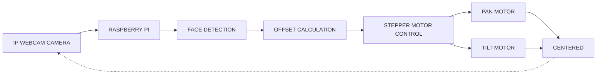

<div align="center">

## Automated Gimbal System for Speaker-centric Recording and Surveillance


**An AI-powered gimbal that automatically tracks a speaker in real time, keeping them centered for smooth, hands-free recording.**

Built in collaboration with Winstone Onyango ([GitHub](https://github.com/Winstone-Onyango/) · [LinkedIn](https://www.linkedin.com/in/winstone-onyango-663417282)).

<p align="center">
  
</p>

</div>

---

## Why This Project?

> Traditional camera setups often require manual operation, making it difficult to continuously keep a speaker or subject within the camera frame during lectures, events, and surveillance. Existing automated tracking systems can also be expensive and complex to deploy. This project addresses this challenge by developing a low-cost robotic gimbal system that uses computer vision to detect and track a speaker in real time, automatically controlling pan and tilt movement to keep the subject centered while recording.

The system combines a **Raspberry Pi 4**, an **IP webcam mobile application**, a **deep neural network (DNN) face detector**, and a **dual stepper motor pan-tilt mechanism**. It runs entirely on the edge, with no cloud. Plug it in, power it up, and the gimbal handles the rest. Whether you are recording a lecture, streaming a presentation, or setting up an unattended surveillance node, the gimbal keeps the subject locked in frame without any human intervention.

---

## How It Works



The pipeline is a closed feedback loop. Each frame captured from the IP webcam is analyzed by the DNN face detector, which returns the coordinates of the speaker's face. The system compares the face center against the frame center to compute a horizontal and vertical offset. These offsets pass through an exponential smoothing filter to eliminate jitter, and are then converted into step and direction commands for the pan and tilt stepper motors. The motors adjust the camera's orientation, and the loop repeats, keeping the speaker locked at the center of the frame in real time.

---

## System Overview

| Layer | Component | Role |
|---|---|---|
| **Input** | IP Webcam (phone stream) | Streams MJPEG video over HTTP |
| **Compute** | Raspberry Pi 4 Model B | Runs detection, tracking logic, and motor control |
| **Vision** | OpenCV DNN (ResNet-10 SSD) | Detects faces in each frame |
| **Control** | GPIO + A4988/DRV8825 drivers | Converts logic into stepper pulses |
| **Actuation** | 2× NEMA 17 stepper motors | Pan (horizontal) and tilt (vertical) motion |
| **Structure** | 3D-printed pan-tilt bracket | Mechanical support and axis alignment |
| **Power** | 12V 2A (motors) + 5V 3A (Pi) | Isolated supplies for noise-free operation |

---

## 3-D Printed Parts and Assembly

The mechanical frame of the gimbal is fully 3D-printed, making it easy to replicate, modify, and repair. All parts were designed in **AutoCAD** and printed.

<p align="center">
  
</p>

---

## Circuit Diagram

The electronics are built around the Raspberry Pi's GPIO header. Each stepper motor is driven by a dedicated A4988 or DRV8825 driver module, which handles the high-current coil switching while the Pi only provides step, direction, and enable signals.

<p align="center">
  
</p>

### GPIO Pinout (BCM)

| Motor | STEP | DIR | ENABLE |
|---|---|---|---|
| Pan (X-axis) | GPIO 17 (pin 11) | GPIO 27 (pin 13) | GPIO 22 (pin 15) |
| Tilt (Y-axis) | GPIO 23 (pin 16) | GPIO 24 (pin 18) | GPIO 25 (pin 22) |

Drivers are configured for **1/8 microstepping** (1600 steps per revolution on a 1.8° NEMA 17).

---

## Complete Data Flow

1. **Capture**: The IP webcam streams MJPEG frames over HTTP to the Raspberry Pi.
2. **Preprocess**: Every second frame is resized to 320 px width to reduce inference time.
3. **Detect**: The ResNet-10 SSD model detects all faces and returns bounding boxes with confidence scores (threshold 0.6).
4. **Select**: The face closest to the previously tracked position (within a region of interest) is chosen as the target; otherwise the highest-confidence face is used. This keeps the gimbal locked on the same speaker when several faces are in view.
5. **Calculate Offset**: The face center is compared against the frame center to compute Δx and Δy.
6. **Smooth**: An exponential filter (α = 0.45) removes jitter and prevents motor oscillation.
7. **Dead Zone Check**: If the offset is below 30 px, no movement is triggered.
8. **Control**: Step count and step delay are computed proportionally to the offset magnitude, with acceleration and deceleration ramping.
9. **Actuate**: Pan and tilt motors move asynchronously in background threads.
10. **Repeat**: The loop runs continuously, keeping the speaker centered.

<p align="center">
  
</p>

<p align="center">
  
</p>

---

## Project Structure

```
.
├── src/
│   ├── gimbal.py       # Face detection, tracking loop, and stepper motor control
│   └── test.py         # Standalone pan/tilt motor test sequence
├── start.sh            # Creates the venv, installs dependencies, runs the tracker
├── gimbal.service      # systemd unit to start the tracker on boot
└── requirements.txt
```

---

## Getting Started

### Requirements

- Raspberry Pi 4 running Raspberry Pi OS with Python 3.8+
- A phone running an IP webcam app on the same network as the Pi
- Wiring as shown in the circuit diagram above

### Configuration

Set the camera stream URL in `src/gimbal.py`:

```python
camera_url_two = "http://<phone-ip>:8080/video"
```

Tracking behaviour can be tuned through the constants at the top of the same file (`DEAD_ZONE`, `SMOOTHING_FACTOR`, `MAX_ADJUSTMENT_STEPS`, speed and acceleration settings).

### Run

```bash
python3 -m venv venv
source venv/bin/activate
pip install -r requirements.txt
python src/gimbal.py
```

On first run, the DNN model files (`deploy.prototxt` and `res10_300x300_ssd_iter_140000.caffemodel`) are downloaded automatically. When `RPi.GPIO` is not available (for example on a laptop), the script runs in **simulation mode** and logs the motor moves instead of driving the GPIO pins.

To check the wiring without running the tracker, run `python src/test.py`, which steps each motor in both directions.

### Run on Boot

`start.sh` and `gimbal.service` expect the project to be in `/home/titan/project` and run as user `titan`; adjust the paths and user to match your Pi.

```bash
sudo cp gimbal.service /etc/systemd/system/
sudo systemctl daemon-reload
sudo systemctl enable --now gimbal.service
journalctl -u gimbal.service -f   # follow logs
```

### Keyboard Controls

These work when the preview window is enabled (`cv2.imshow` is commented out by default for headless use).

| Key | Action |
|---|---|
| `q` | Quit |
| `c` | Center motors (return to home position) |
| `d` | Disable motors (save power) |
| `e` | Enable motors |
| `r` | Reset position counters to zero |
